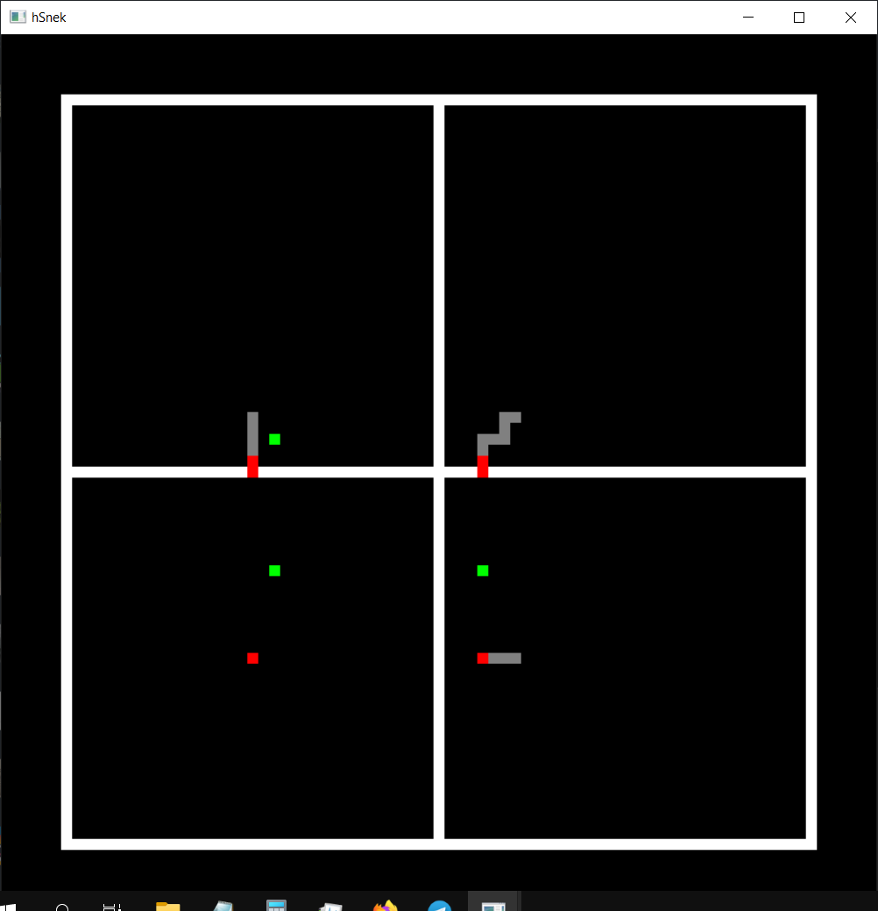

# hSnek



This is a simple 4D Snake game, projected on 4 separate 2D planes, each of 4 lines in the middle represents one coordinate axis.

## Installation

### From releases (Windows only)

* Download .zip from [releases](https://github.com/DEYTD/hSnek/releases)
* ensure that dll and exe are in the same directory
* Launch the game `hSnek.exe`

### From source

You need to have [Haskell Stack](https://haskellstack.org) installed.

```sh
git clone https://github.com/DEYTD/hSnek.git
cd hSnek
stack build
stack ghc
./hSnek
```

## Controls

> controls only work with an English keyboard layout

* WASD, arrow keys - movement
* R - restart


